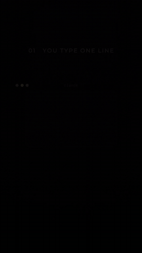

<h1 align="center">onbeat</h1>
<p align="center"><b>A Claude skill that makes beat-synced edits.</b><br>
Give Claude a song and your words, clips or a reference video. It finds every beat, kick and drop, then renders the edit.</p>

<p align="center">
  <a href="https://github.com/flxppr/onbeat-skill/actions/workflows/test.yml"></a>
  
  
</p>

<p align="center"></p>
<p align="center"><a href="docs/demo.mp4"><b>▶ Watch it with sound</b></a> · this video was made by onbeat itself: <a href="examples/demo/edit.py">examples/demo/edit.py</a></p>

```
> make a motivational edit to song.mp3, 9:16, lines below, words on the kicks
> cut my clips in ./footage to this song, slow-mo intro, one cut per beat after the drop
> copy the style of reference.mp4 onto my song
```

## Install

### Let Claude do it

Paste this into [Claude Code](https://claude.com/claude-code):

```text
Install the onbeat skill for me. Clone https://github.com/flxppr/onbeat-skill into my
Claude skills folder as a folder named "onbeat" (~/.claude/skills/onbeat, or
%USERPROFILE%\.claude\skills\onbeat on Windows). Then run
"pip install -r requirements.txt" inside it and run "python tests/test_beats.py" to
check that it works. Tell me when it's ready.
```

Then start a new Claude Code session and ask for an edit.

### Or do it yourself

You need [Claude Code](https://claude.com/claude-code), Python 3.9+ and git. ffmpeg comes with the requirements if you don't have it.

```bash
git clone https://github.com/flxppr/onbeat-skill ~/.claude/skills/onbeat
pip install -r ~/.claude/skills/onbeat/requirements.txt
```

On Windows (PowerShell):

```powershell
git clone https://github.com/flxppr/onbeat-skill "$env:USERPROFILE\.claude\skills\onbeat"
pip install -r "$env:USERPROFILE\.claude\skills\onbeat\requirements.txt"
```

The folder has to be called `onbeat`. Start a new Claude Code session, then ask for an edit or type `/onbeat`.

## What it does

- **Finds the beat for you.** Tempo, bar starts, kicks, snares and the drop, as a map Claude writes the edit against. It uses only numpy and ffmpeg, fits a steady grid so the beats don't drift by the chorus, and holds up on loud, clipped TikTok audio.
- **Copies a reference edit.** Give it a TikTok you like. It detects every cut and checks how the cuts line up with the music (on the beat? on bar starts? how many beats per shot?). It notices if the editor cuts a frame or two early and copies that too, spots flashes and camera punches on the kicks, pulls the colour palette and makes contact sheets. Claude turns all that into a style guide, you approve it, then it builds.
- **Never guesses your style.** With no reference and only a vague description, Claude renders 3-4 different interpretations as stills and lets you pick before rendering anything.
- **Kinetic typography and footage.** Words that snap in on the kicks, strike-throughs, counters, glows, slams on the drop, and footage cut on the beat (landscape clips fit into 9:16 over a blurred copy). Plus flashes, whips, glitches, zoom punches on every kick, grain and grades.
- **Checks its own work.** Every edit gets a timeline (each word with its bar and beat) and a contact sheet that Claude looks at before rendering.
- **Fast enough.** Renders run in parallel on all your cores. A 24-second 1080x1920 edit takes about 40 seconds on an 8-core machine.

## Try it without Claude

```bash
cd ~/.claude/skills/onbeat/examples/demo
python edit.py timeline   # every scene and word with its bar/beat
python edit.py sheet      # contact sheet of key frames
python edit.py render     # edit.mp4 (the song is generated on the first run, royalty-free)
```

`examples/kinetic` is a motivational text edit. `examples/montage` cuts footage to the beat (put clips in `examples/montage/clips/` first).

## How it works

| step | what runs | output |
|---|---|---|
| 1. beats | `scripts/beats.py` | `beats.json`, a plot of beats/kicks/drop, a click track to check by ear |
| 2. style | `scripts/analyze_ref.py`, a preset in `styles/`, or options you pick from | `STYLE.md` |
| 3. plan | Claude, using the beat map | a beat sheet: a scene per bar, words on hits, the drop moment |
| 4. build | Claude writes `edit.py` with `scripts/engine.py` | `timeline`, `sheet.png` |
| 5. render | `python edit.py preview`, then `render` | `edit.mp4` with the song |

An edit is a short Python file:

```python
from engine import *
ed = Edit('song.mp3', size=(1080, 1920))
B = ed.beats
s = ed.scene(B.bar(0), B.bar(1), bg='spotlight', punch='kicks', intro='flash')
s.add(Words("DON'T *STOP*", B.between('kicks', B.bar(0), B.bar(1)), size=160))
s = ed.scene(B.drop, B.drop + 2 * B.period, bg='gold')
s.add(Text('NOW.', B.drop, size=380, anim='slam', glow=30))
ed.run()
```

The whole API is in [SKILL.md](SKILL.md).

## Style presets

- **motivational-kinetic:** dark spotlight, condensed caps on the kicks, strike-and-replace payoffs, gold on the drop.
- **bw-glitch:** black and white, huge stretched words, monospace system text, glitch hits.
- **hype-montage:** your clips, slow-mo intro, a cut on every beat after the drop, flashes and punches.

To add your own, run `analyze_ref.py` on an edit you like and save the style guide Claude writes into `styles/`.

## Notes

- Use music you have the rights to. Platforms may mute copyrighted audio; posting with the platform's own sound is the usual workaround.
- `python scripts/beats.py --help`, `python scripts/analyze_ref.py --help` and `python scripts/engine.py fonts` all work on their own.
- Self-tests: `python tests/test_beats.py` (tempo, beat timing, downbeats, drop, kicks, loud clipped masters) and `python tests/test_ref.py` (renders a test edit and checks that the reference analysis reads it back).
- Built and tested on Windows 11 with Python 3.9 to 3.14. The tests also run on macOS and Linux on every push. Fonts fall back to whatever the system has.

## License

MIT
